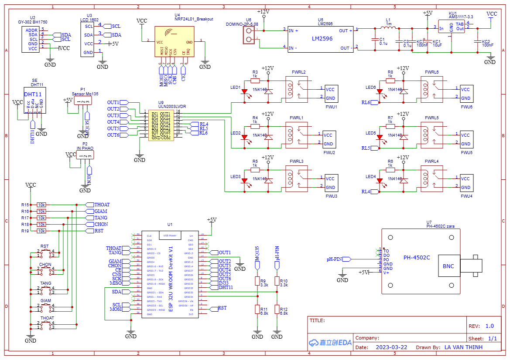
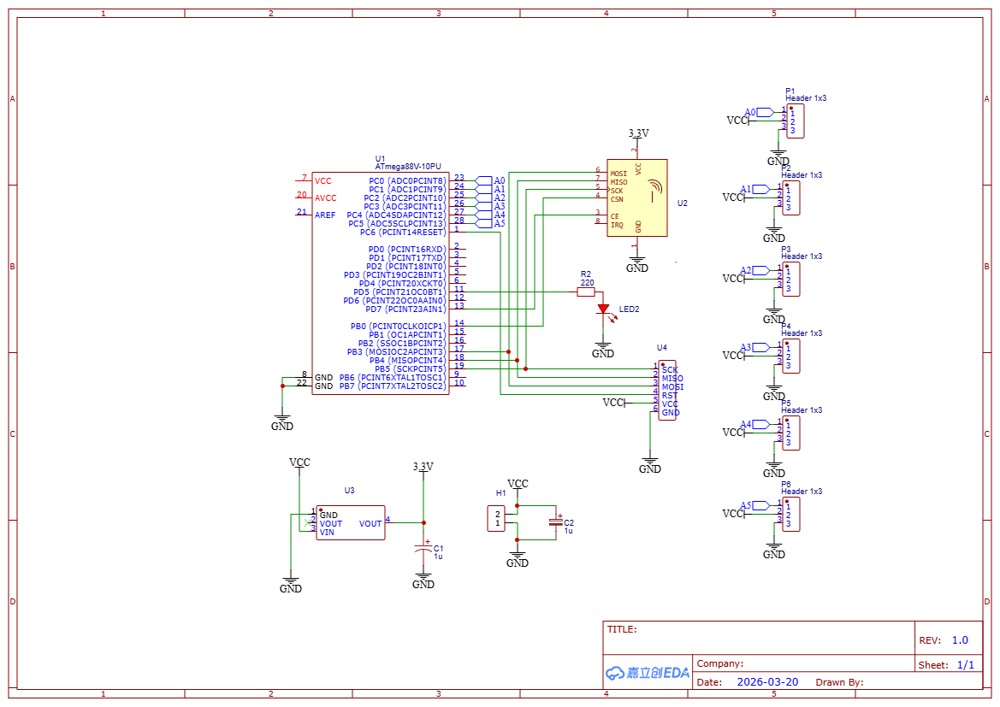
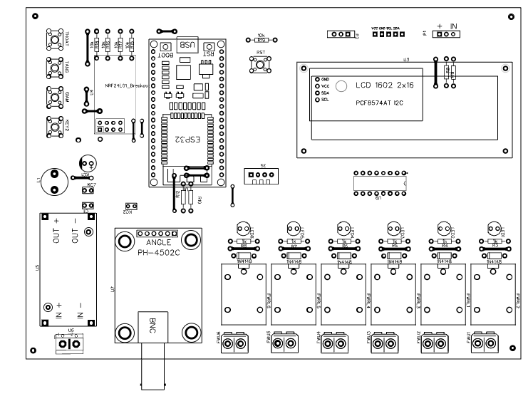
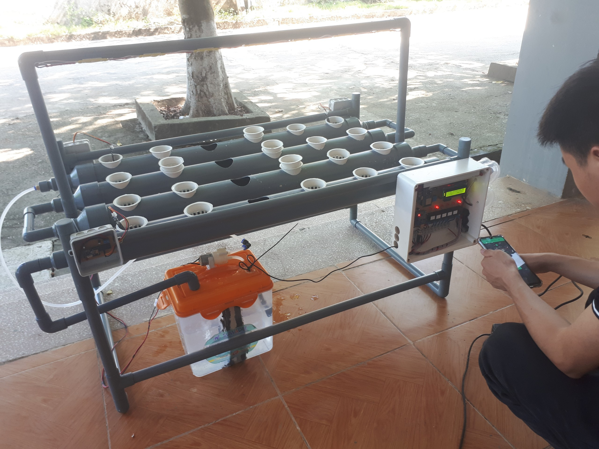
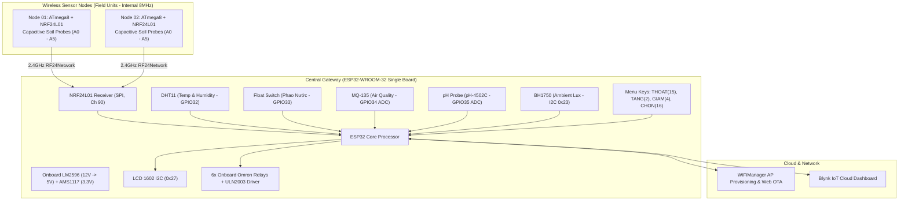

# Smart Agriculture IoT Monitoring & Automation System
### Hệ Thống IoT Giám Sát Môi Trường & Điều Khiển Nông Nghiệp Thông Minh

[](file:///hardware/)
[](file:///firmware/)
[](file:///mechanical/)
[](file:///LICENSE)

---

## 1. Giới thiệu dự án (Project Overview)

**Smart Agriculture IoT System** là hệ thống phần cứng và firmware IoT mã nguồn mở phục vụ nông nghiệp công nghệ cao và nhà màng thông minh do **Kỹ sư La Văn Thịnh** thiết kế. Dự án giải quyết bài toán giám sát đa thông số vi khí hậu và tự động hóa tưới tiêu phân bón chính xác, không dây và tiết kiệm chi phí:

- **Gateway Trung Tâm (ESP32-WROOM-32 Single Board)**: Bo mạch tích hợp nguyên khối bao gồm bộ hạ áp xung hiệu suất cao **LM2596-5.0V**, ổn áp tuyến tính **AMS1117-3.3V**, mảng khuếch đại Darlington **ULN2003APG**, 6 rơ-le công nghiệp **Omron G5LE-14**, mạch phân áp bảo vệ ADC 3.3V, cổng phao nước, cổng màn hình LCD I2C và khối thu phát sóng 2.4 GHz NRF24L01.
- **Node Cảm Biến Không Dây (ATmega8 / ATmega88 + NRF24L01)**: Hoạt động bằng pin Li-ion 18650 tích hợp sạc Type-C TP4056, chạy dao động nội 8MHz siêu tiết kiệm điện, mở rộng cắm đến 6 que đo độ ẩm đất điện dung (Capacitive Soil Moisture) chống ăn mòn và truyền gói tin RF định kỳ về Gateway.
- **Hệ Thống Chấp Hành 6 Kênh Onboard**: Điều khiển trực tiếp 6 tải độc lập (Bơm 1, Bơm 2, Phun sương ẩm, Quạt thông gió, Bơm tổng / Sưởi, Đèn chiếu sáng) theo thuật toán chống rung chu kỳ (Hysteresis control).
- **Giao Diện HMI Cục Bộ & Đám Mây**: Màn hình LCD 1602 I2C + 4 phím bấm công nghiệp (`THOAT`, `TANG`, `GIAM`, `CHON`) để cài đặt ngưỡng trực tiếp, đồng thời đồng bộ trạng thái lên ứng dụng di động Blynk IoT qua WiFi (tích hợp WiFiManager cấu hình AP và Web OTA).

---

## 2. Sơ Đồ Nguyên Lý & Bản Vẽ Kỹ Thuật (Official Schematics & Layout)

| Sơ Đồ Nguyên Lý Trạm Gateway Trung Tâm | Sơ Đồ Nguyên Lý Sensor Node ATmega8 |
| :---: | :---: |
| [](file:///hardware/schematics/png/Schematic_Gateway_Server.png) | [](file:///hardware/schematics/png/Schematic_Sensor_Node_ATmega8.png) |

| Bố Trí Mạch In PCB Gateway (Silkscreen) | Triển Khai Thực Tế Tại Nhà Kính Thủy Canh |
| :---: | :---: |
| [](file:///hardware/pcb/png/PCB_Gateway_Server.png) | [](file:///docs/images/system_field_deployment_greenhouse.png) |

---

## 3. Kiến trúc hệ thống (System Architecture)



---

## 4. Cấu trúc thư mục mã nguồn & phần cứng

Repository được chuẩn hóa theo cấu trúc mã nguồn mở chuyên nghiệp:

```text
.
├── README.md                           # Tài liệu tổng quan dự án
├── LICENSE                             # Giấy phép mã nguồn mở MIT
├── .gitignore                          # Loại trừ file nhạy cảm, build cache, binaries
├── docs/                               # Tài liệu kỹ thuật chi tiết
│   ├── architecture.md                 # Kiến trúc hệ thống, sơ đồ khối, luồng nguồn, thư viện ảnh mạch
│   ├── user-guide.md                   # Hướng dẫn vận hành: WiFi AP portal, Web OTA, Menu LCD, Blynk
│   ├── bom.md                          # Danh mục linh kiện (BOM) & thông số kỹ thuật 100% khớp sơ đồ
│   ├── wiring.md                       # Sơ đồ đấu nối, bảng pinout và mức điện áp
│   ├── assembly.md                     # Hướng dẫn gia công PCB, hàn linh kiện & in 3D
│   ├── testing.md                      # Quy trình kiểm thử, hiệu chuẩn cảm biến
│   ├── known-issues.md                 # Lưu ý thiết kế phần cứng, chống sụt áp RF, phân áp ADC
│   └── images/                         # Ảnh chụp mạch thật, sơ đồ PCB, mô hình 3D, giao diện
├── hardware/                           # Thiết kế mạch điện tử (EDA & Gerber)
│   ├── schematics/
│   │   ├── easyeda/                    # File nguồn nguyên lý EasyEDA JSON
│   │   ├── pdf/                        # Sơ đồ nguyên lý PDF
│   │   └── png/                        # Bản vẽ sơ đồ nguyên lý độ phân giải cao
│   ├── pcb/
│   │   ├── easyeda/                    # File nguồn mạch in PCB EasyEDA JSON
│   │   ├── sprint_layout/              # File layout Sprint-Layout 6.0 (.lay6)
│   │   ├── gerber/                     # File Gerber RS-274X & Drill sẵn sàng đặt mạch
│   │   ├── png/                        # Bản vẽ bố trí mạch in Top Silkscreen
│   │   └── etch_masks_pdf/             # Bản in layout 1:1 làm mạch in thủ công
│   └── pinouts/                        # Tài liệu pinout module ESP32, NRF24, MQ135
├── mechanical/                         # Thiết kế cơ khí & vỏ hộp in 3D
│   └── 3d_models/
│       ├── gateway_enclosure/          # Vỏ hộp Gateway Box & Lid (STL, 3MF)
│       ├── sensor_brackets/            # Đế gá cảm biến BH1750, chụp bảo vệ MQ-135
│       └── node_enclosure/             # Vỏ hộp node không dây RF-Nano (STL)
└── firmware/                           # Mã nguồn lập trình nhúng
    ├── gateway_esp32/                  # Dự án PlatformIO hoàn chỉnh cho ESP32
    │   ├── platformio.ini
    │   ├── src/main.cpp
    │   ├── include/FarmConfig.h
    │   └── lib/                        # Thư viện driver nRF24, Blynk, MQ135...
    ├── gateway_arduino_ide/            # Phiên bản sketch Arduino IDE dự phòng
    └── sensor_nodes_atmega/            # Firmware cho các Node ATmega8 / 88
        ├── node01_soil_moisture/
        ├── node02_soil_moisture/
        └── receiver_test/
```

---

## 5. Danh mục linh kiện chính (BOM Summary)

| Linh kiện | Model / Thông số | Vai trò | Số lượng |
| :--- | :--- | :--- | :---: |
| **ESP32 DevKit** | ESP32-WROOM-32 (38-pin DevKit V1) | Gateway trung tâm, WiFi/Blynk, Web OTA, HMI | 1 |
| **Vi điều khiển AVR** | ATmega8A-PU / ATmega88V-10PU DIP-28 | MCU đọc cảm biến cho các Node ngoài vườn (Internal 8MHz) | 5 |
| **Module RF 2.4GHz** | NRF24L01+ Breakout | Truyền nhận không dây cự ly xa (Mesh/Star) | 6 |
| **Dàn 6 Rơ-le Onboard** | **Omron G5LE-14 12VDC** (10A 250VAC) | Đóng cắt bơm 1, 2, phun sương, quạt, sưởi, đèn | 6 |
| **IC Đệm Công Suất** | **ULN2003APG / ULN2003LVDR** DIP-16 | Mảng Darlington kéo trực tiếp cuộn hút 6 rơ-le | 1 |
| **Khối Nguồn Xung** | **LM2596-5.0V** (TO-263/TO-220) + L1 ($1\text{mH}$) | Hạ áp nguồn tổ ong 12V xuống 5V (3A) cho hệ thống | 1 |
| **Ổn Áp Tuyến Tính** | **AMS1117-3.3V** (SOT-223) | Cấp nguồn sạch 3.3V cách ly riêng cho NRF24L01 | 2 |
| **Cầu Phân Áp ADC** | Điện trở $3.3\text{k}\Omega$ ($R_9, R_{10}$) & $6.8\text{k}\Omega$ ($R_{11}, R_{12}$) | Hạ áp tín hiệu analog $5\text{V} \rightarrow 3.37\text{V}$ bảo vệ ADC ESP32 | 4 |
| **HMI 4 Phím Bấm** | Phím nhấn công nghiệp `K4-6x6_TH` | Điều hướng: THOAT (15), TANG (2), GIAM (4), CHON (16) | 4 |
| **Cảm biến độ ẩm đất** | Capacitive Soil Moisture v1.2/v2.0 | Cảm biến điện dung chống ăn mòn (hỗ trợ tối đa 6 que/node) | 5 |
| **Cảm biến nhiệt ẩm** | DHT11 Digital Sensor | Đo nhiệt độ và độ ẩm không khí (GPIO 32) | 1 |
| **Cảm biến khí gas** | MQ-135 Air Quality Sensor | Giám sát khí NH3, CO2, mùi hữu cơ (GPIO 34 ADC) | 1 |
| **Cảm biến ánh sáng** | GY-302 (BH1750 Digital Lux I2C) | Đo quang thông ánh sáng mặt trời (GPIO 21/22) | 1 |
| **Cảm biến đo độ pH** | pH-4502C + Điện cực BNC Glass Probe | Đo độ pH dung dịch dinh dưỡng/nước tưới (GPIO 35 ADC) | 1 |
| **Cảm biến phao nước** | Phao cơ tiếp điểm báo mức | Cảnh báo chống cạn bể chứa nước (GPIO 33) | 1 |
| **Màn hình hiển thị** | LCD1602 + PCF8574T I2C Backpack | Hiển thị thông số tại tủ điều khiển (Địa chỉ `0x27`) | 1 |
| **Bộ sạc & Pin** | TP4056 Type-C + Cell Li-ion 18650 | Nguồn độc lập cho các Node ngoài vườn | 5 |

*Xem chi tiết toàn bộ mã linh kiện, đơn giá và quy cách tại [docs/bom.md](file:///docs/bom.md).*

---

## 6. Hướng dẫn nạp Firmware (Getting Started)

### Yêu cầu môi trường
- [Visual Studio Code](https://code.visualstudio.com/) + Extension [PlatformIO IDE](https://platformio.org/)
- Hoặc [Arduino IDE 2.x](https://www.arduino.cc/en/software) với ESP32 Board Package và MiniCore (cho ATmega8)

### Cách 1: Nạp Gateway ESP32 bằng PlatformIO (Khuyến nghị)
1. Mở thư mục [`firmware/gateway_esp32`](file:///firmware/gateway_esp32) bằng VS Code PlatformIO.
2. Cắm cáp Micro-USB / Type-C kết nối ESP32 với máy tính.
3. Chạy lệnh build & nạp:
   ```bash
   pio run --target upload
   pio device monitor -b 115200
   ```
4. Khi khởi động lần đầu, ESP32 sẽ phát WiFi AP để bạn dùng điện thoại kết nối và cài đặt WiFi nhà kính qua giao diện web.

### Cách 2: Nạp Firmware cho Node ATmega8
1. Mở file [`firmware/sensor_nodes_atmega/node01_soil_moisture/node01_soil_moisture.ino`](file:///firmware/sensor_nodes_atmega/node01_soil_moisture/node01_soil_moisture.ino) trong Arduino IDE.
2. Chọn Board: **MiniCore -> ATmega8**.
   - Clock: **Internal 8 MHz** (Không cần thạch anh ngoài).
   - Bootloader: Yes / No.
3. Sử dụng mạch nạp USBasp cắm vào cổng header ISP 1x6 ($U_4$) để nạp code cho chip.

---

## 7. Trạng thái kiểm thử phần cứng & Xác minh thực tế

- [x] **Mạch in & Hàn linh kiện**: Đã hoàn thành chế tạo PCB 1 lớp và hàn hoàn thiện mạch Gateway và Node.
- [x] **Truyền nhận NRF24**: Đã kiểm thử giao tiếp ổn định giữa Node 01, Node 02 và Gateway ở tốc độ 2Mbps Channel 90 (đã gắn tụ $10\mu\text{F}$ chống sụt áp RF).
- [x] **Đọc cảm biến**: Cảm biến DHT11, BH1750, MQ-135 và cảm biến điện dung đất đọc chính xác giá trị thực.
- [x] **Màn hình & Phím bấm**: Hệ thống menu LCD 1602 điều khiển bằng 4 phím bấm hoạt động mượt mà.
- [x] **Rơ-le tự động**: Thuật toán Hysteresis đóng ngắt bơm và quạt đúng ngưỡng cài đặt.
- [x] **Vỏ hộp in 3D**: Vỏ hộp Gateway Box và đế cảm biến BH1750 khớp cơ khí và bảo vệ tốt bo mạch.

---

## 8. Tác giả & Giấy phép (Authors & License)

- **Tác giả & Thiết kế phần cứng**: **Kỹ sư La Văn Thịnh** ([@vthinh-la](https://github.com/vthinh-la))
- **Giấy phép**: Phát hành theo giấy phép mã nguồn mở **[MIT License](file:///LICENSE)**. Mọi cá nhân, sinh viên, kỹ sư và doanh nghiệp tự do sử dụng, chỉnh sửa, thương mại hóa và phát triển tiếp.
