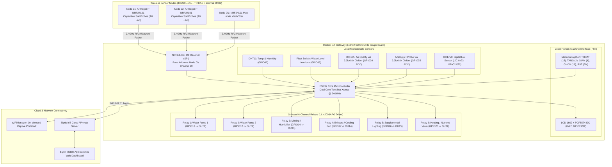
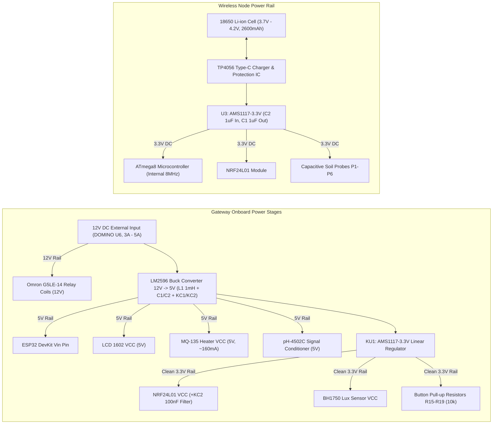

# System Architecture & Technical Specification

## 1. Overview

The **Smart Agriculture IoT System** is a distributed telemetry and automated actuation platform designed for greenhouse and high-tech agricultural management. The system consists of:
1. **Wireless Remote Sensor Nodes (ATmega8/ATmega88 + NRF24L01)**: Ultra-low power, battery-operated field units running on internal 8MHz RC oscillator. Each node can host up to 6 capacitive soil moisture probes (P1–P6) to monitor volumetric soil moisture across distinct garden beds without messy field wiring.
2. **Central IoT Gateway / Controller (ESP32-WROOM-32)**: Single-board industrial-grade controller integrating an LM2596 switching buck converter, AMS1117-3.3 linear regulator, ULN2003APG Darlington driver array, and 6 onboard Omron G5LE-14 SPDT relays. It aggregates local microclimate data (DHT11, MQ-135, BH1750, pH probe, water float switch), receives RF telemetry over 2.4 GHz RF24Network, drives an I2C LCD with a 4-button menu interface, and executes automated hysteresis control.
3. **Cloud & Mobile Dashboard (Blynk IoT / WiFiManager)**: Remote telemetry visualization, manual override triggers, and WiFi AP captive portal provisioning.

---

## 2. System Architecture Diagram

---

## 3. Power Distribution Tree

---

## 4. Control Logic & Hysteresis Algorithm

To prevent rapid oscillation (relay chattering / hunting) near trigger setpoints, all actuator channels implement dual-threshold hysteresis:

$$\text{Actuator State} = \begin{cases} 
\text{ON} & \text{if } \text{SensorValue} < \text{Threshold}_{\text{ON}} \\
\text{OFF} & \text{if } \text{SensorValue} > \text{Threshold}_{\text{OFF}} \\
\text{Unchanged} & \text{if } \text{Threshold}_{\text{ON}} \le \text{SensorValue} \le \text{Threshold}_{\text{OFF}}
\end{cases}$$

### Actuation Matrix:
| Actuator | Control Parameter | Sensor Source | Default ON Trigger | Default OFF Trigger | Safety Interlock |
| :--- | :--- | :--- | :--- | :--- | :--- |
| **Relay 1** (Pump 1) | Soil Moisture Node 01 | Remote NRF24 (A0) | $< 35\%$ | $> 70\%$ | Water float switch cạn bể |
| **Relay 2** (Pump 2) | Soil Moisture Node 02 | Remote NRF24 (A1) | $< 35\%$ | $> 70\%$ | Water float switch cạn bể |
| **Relay 3** (Humidifier) | Air Humidity | DHT11 (Local) | $< 50\%$ | $> 75\%$ | Anti-dry run protection |
| **Relay 4** (Exhaust Fan) | Air Temp / Gas PPM | DHT11 / MQ-135 | $> 32^\circ\text{C}$ or $> 300\text{ ppm}$ | $< 27^\circ\text{C}$ and $< 150\text{ ppm}$ | Manual override |
| **Relay 5** (Lighting) | Sunlight Intensity | BH1750 (Local) | $< 500\text{ Lux}$ | $> 2500\text{ Lux}$ | Schedule & Lux combo |
| **Relay 6** (Nutrient/Aux) | Water pH level | Analog pH Probe | Outside $[5.8, 6.8]$ | Inside $[6.0, 6.5]$ | Dose rate limiter |

---

## 5. RF24Network Communication Protocol

- **Frequency Band**: 2.400 GHz - 2.4835 GHz ISM Band.
- **RF Channel**: Channel 90 ($2400 + 90 = 2490\text{ MHz}$) to isolate from standard 2.4GHz WiFi channels (Channels 1, 6, 11).
- **Data Rate**: `RF24_2MBPS` / `RF24_1MBPS`.
- **Addressing**:
  - Central Gateway: Base Node `00` (Octal).
  - Field Sensor 1: Node `01` (Octal).
  - Field Sensor 2: Node `02` (Octal).
- **Packet Structure**:
  - `RF24NetworkHeader(node00)`
  - Payload buffer: `unsigned long data[6]` containing calibrated soil moisture readings across channels A0 to A5.

---

## 6. Sơ Đồ Nguyên Lý & Layout Bản Vẽ Kỹ Thuật (Official Schematics & PCB)

Dưới đây là các bản vẽ nguyên lý và bố trí linh kiện chính thức được trích xuất trực tiếp từ file thiết kế CAD của tác giả (Kỹ sư La Văn Thịnh):

### A. Sơ Đồ Nguyên Lý Trạm Gateway Trung Tâm (ESP32 Gateway Schematic)
Bản vẽ thể hiện trọn vẹn khối vi điều khiển ESP32, khối hạ áp LM2596, khối đệm ULN2003, dàn 6 rơ-le Omron, mạch phân áp bảo vệ ADC và ma trận phím HMI:

### B. Bố Trí Mạch In Trạm Gateway (Gateway PCB Silkscreen & Layout)
Bản vẽ in lụa mặt trên (Top Silkscreen) thể hiện vị trí linh kiện, cọc đấu domino và các phím bấm công nghiệp:

### C. Sơ Đồ Nguyên Lý Điểm Đo Cảm Biến Di Động (ATmega8 Sensor Node Schematic)
Bản vẽ điểm đo không dây ngoài ruộng với vi điều khiển ATmega8 chạy dao động nội 8MHz, module NRF24L01+, khối ổn áp pin AMS1117-3.3V và 6 cổng cắm que đo độ ẩm đất P1–P6:

---

## 7. Triển Khai Thực Nghiệm Thực Tế (Field Deployment Showcase)

Hệ thống đã được chế tạo hoàn thiện, lắp ráp cơ khí và vận hành thử nghiệm tại khoa Nông - Lâm nghiệp, Trường Cao đẳng Nghề Lạng Sơn:

| Tủ Điều Khiển Gateway Lắp Ráp Hoàn Chỉnh | Mô Hình Nhà Kính Thủy Canh Thông Minh |
| :---: | :---: |
|  |  |

| Node Cảm Biến Không Dây Hoàn Thiện | Mạch In PCB Node Cảm Biến | Điểm Đo Cắm Đất Thực Tế |
| :---: | :---: | :---: |
|  |  |  |
