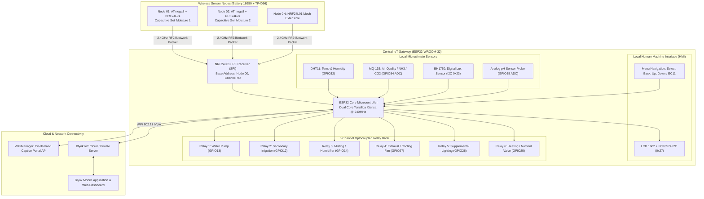
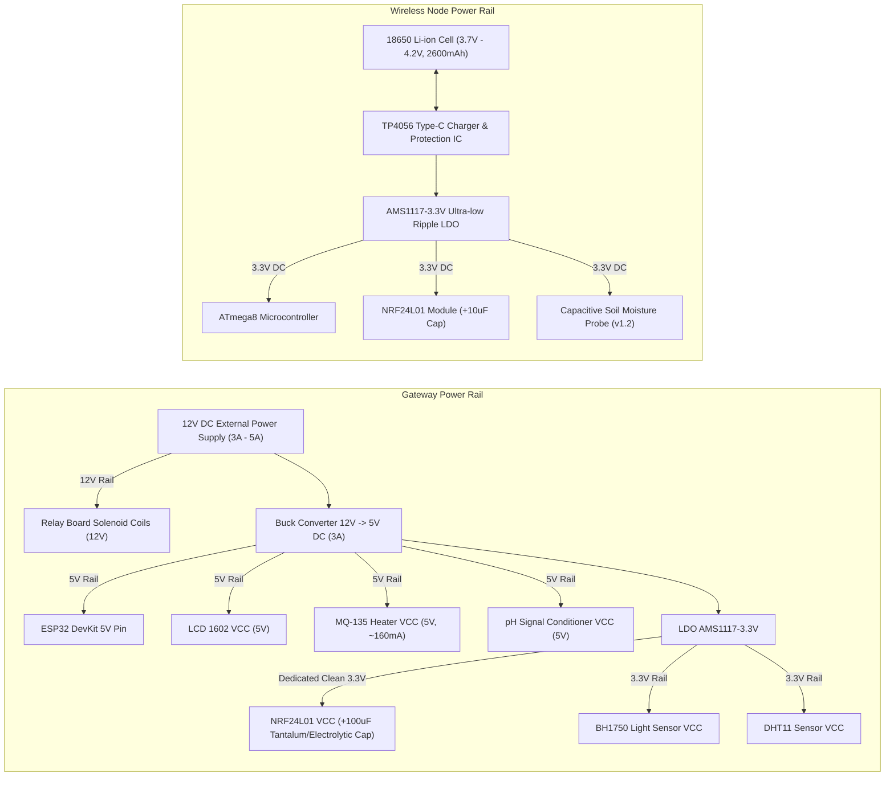
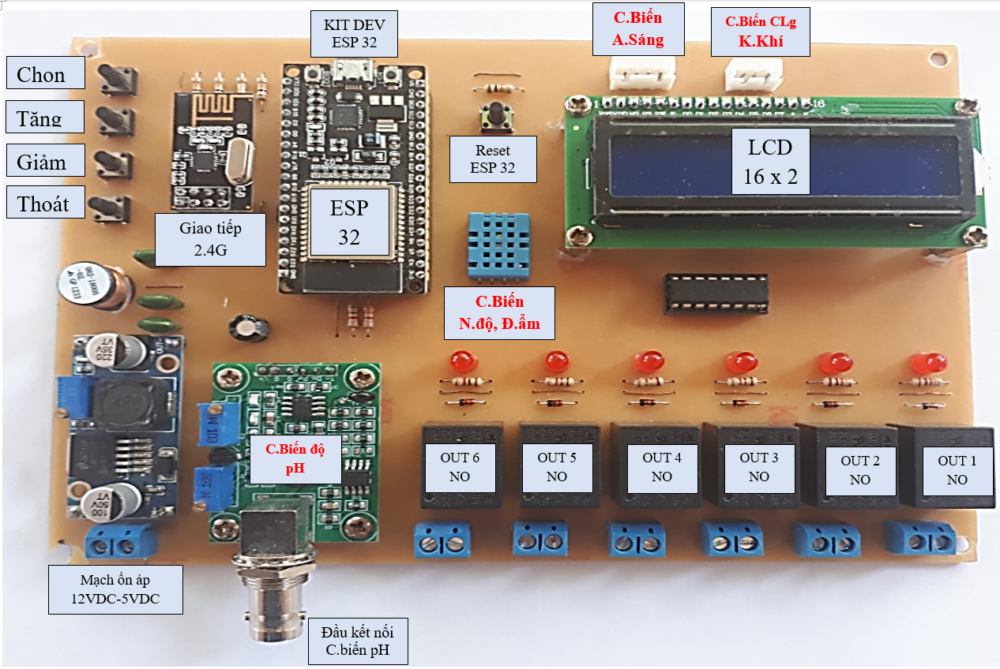
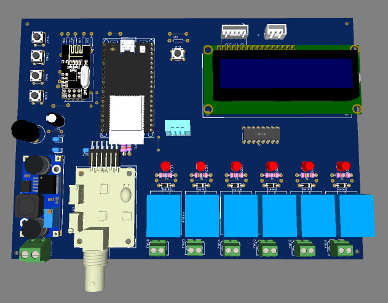
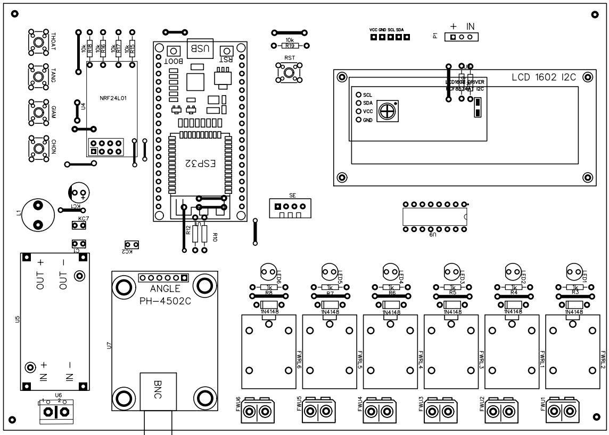
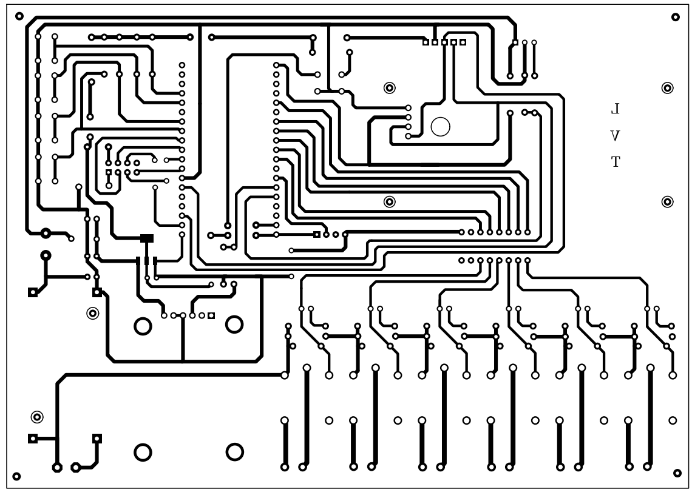
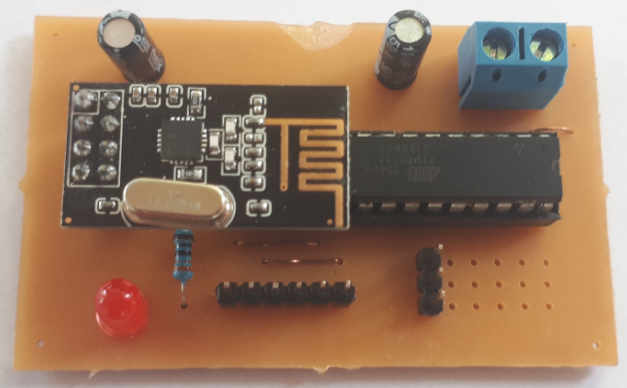
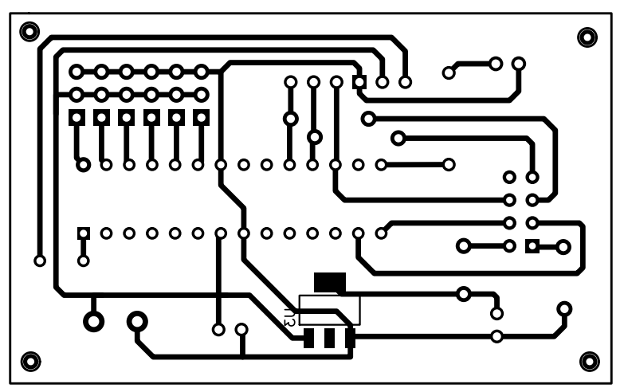
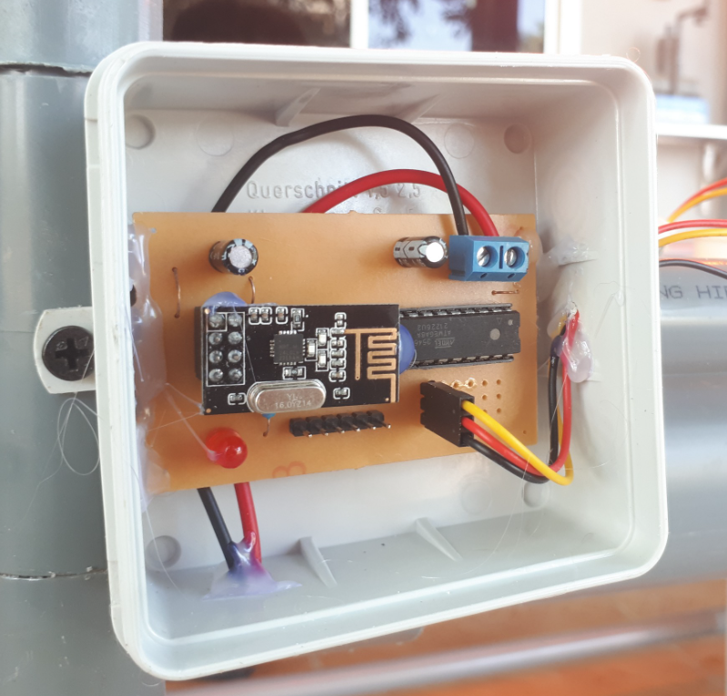

# System Architecture & Technical Specification

## 1. Overview

The **Smart Agriculture IoT System** is a distributed telemetry and automated actuation platform designed for greenhouse and high-tech agricultural management. The system consists of:
1. **Wireless Remote Sensor Nodes (ATmega8/ATmega328P + NRF24L01)**: Battery-powered edge units deployed in the soil bed to monitor volumetric soil moisture continuously without cable clutter.
2. **Central IoT Gateway / Controller (ESP32-WROOM-32)**: Central hub that collects local multi-parameter sensor data (Air Temperature & Humidity, Toxic Gases / Air Quality, Ambient Sunlight Luminosity, Water pH), receives remote soil moisture metrics over 2.4 GHz RF24Network, renders real-time diagnostics on an I2C LCD, and executes intelligent hysteresis-based relay automation for irrigation, ventilation, lighting, and misting.
3. **Cloud & Mobile Dashboard (Blynk IoT / WiFiManager)**: Remote telemetry visualization, manual override triggers, and WiFi AP captive portal provisioning.

---

## 2. System Architecture Diagram

---

## 3. Power Distribution Tree

---

## 4. Control Logic & Hysteresis Algorithm

To prevent rapid oscillation (relay chattering / hunting) near trigger setpoints, all actuator channels implement dual-threshold hysteresis:

$$\text{Actuator State} = \begin{cases} 
\text{ON} & \text{if } \text{SensorValue} < \text{Threshold}_{\text{ON}} \\
\text{OFF} & \text{if } \text{SensorValue} > \text{Threshold}_{\text{OFF}} \\
\text{Unchanged} & \text{if } \text{Threshold}_{\text{ON}} \le \text{SensorValue} \le \text{Threshold}_{\text{OFF}}
\end{cases}$$

### Actuation Matrix:
| Actuator | Control Parameter | Sensor Source | Default ON Trigger | Default OFF Trigger | Safety Interlock |
| :--- | :--- | :--- | :--- | :--- | :--- |
| **Relay 1** (Pump 1) | Soil Moisture Node 01 | Remote NRF24 | $< 35\%$ | $> 70\%$ | Max continuous run timer |
| **Relay 2** (Pump 2) | Soil Moisture Node 02 | Remote NRF24 | $< 35\%$ | $> 70\%$ | Max continuous run timer |
| **Relay 3** (Humidifier) | Air Humidity | DHT11 (Local) | $< 50\%$ | $> 75\%$ | Anti-dry run protection |
| **Relay 4** (Exhaust Fan) | Air Temp / Gas PPM | DHT11 / MQ-135 | $> 32^\circ\text{C}$ or $> 300\text{ ppm}$ | $< 27^\circ\text{C}$ and $< 150\text{ ppm}$ | Manual override |
| **Relay 5** (Lighting) | Sunlight Intensity | BH1750 (Local) | $< 500\text{ Lux}$ | $> 2500\text{ Lux}$ | Schedule & Lux combo |
| **Relay 6** (Nutrient/Aux) | Water pH level | Analog pH Probe | Outside $[5.8, 6.8]$ | Inside $[6.0, 6.5]$ | Dose rate limiter |

---

## 5. RF24Network Communication Protocol

- **Frequency Band**: 2.400 GHz - 2.4835 GHz ISM Band.
- **RF Channel**: Channel 90 ($2400 + 90 = 2490\text{ MHz}$) to isolate from standard 2.4GHz WiFi channels (Channels 1, 6, 11).
- **Data Rate**: `RF24_2MBPS` / `RF24_1MBPS`.
- **Addressing**:
  - Central Gateway: Base Node `00` (Octal).
  - Field Sensor 1: Node `01` (Octal).
  - Field Sensor 2: Node `02` (Octal).
- **Packet Structure**:
  - `RF24NetworkHeader(node00)`
  - Payload buffer: `float data[6]` containing calibrated sensor floats, battery status, and node ID.

---

## 6. Hardware Implementation & Physical Layout Gallery

### A. Central Gateway Controller
The Gateway integrates the ESP32 compute module, power buck regulation, relay isolation, LCD I2C backpack, and the NRF24 RF frontend.

| Assembled Hardware | 3D Board Visualization |
| :---: | :---: |
|  |  |

| PCB Layout - Top Copper / Silkscreen | PCB Layout - Bottom Copper |
| :---: | :---: |
|  |  |

---

### B. Remote Sensor Nodes (Points of Measurement)
Each remote node comprises an ATmega8 MCU, NRF24L01 radio, capacitive soil moisture probe, 18650 Li-ion battery, and TP4056 charging circuit.

| Assembled Sensor Node | Sensor Node PCB Layout | Field Deployment in Soil Bed |
| :---: | :---: | :---: |
|  |  |  |

---

### C. Greenhouse Pilot Deployment
The complete system was deployed and evaluated on a pilot hydroponic and automated greenhouse installation at the Agriculture Department of Lang Son Vocational College:

