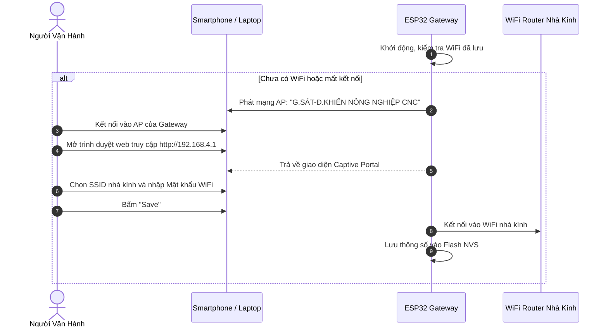
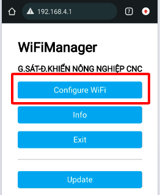
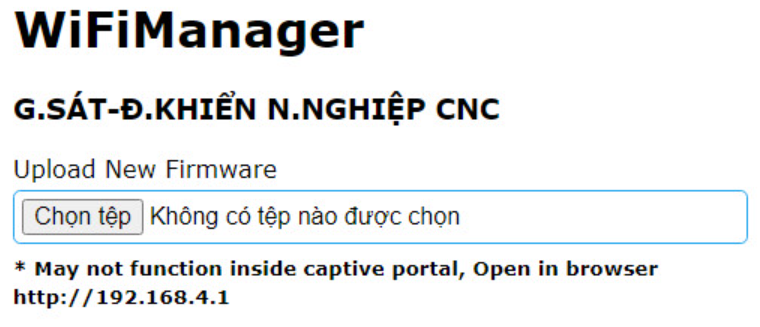
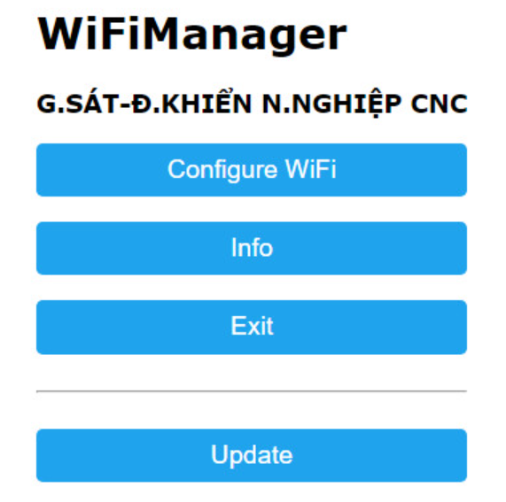
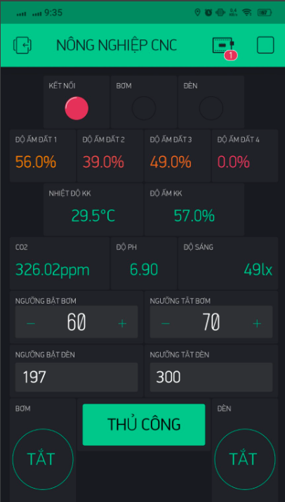

# Hướng Dẫn Vận Hành & Cấu Hình Hệ Thống (User & Operator Guide)

Tài liệu này hướng dẫn chi tiết cách thiết lập kết nối mạng, cài đặt ngưỡng tự động, sử dụng ứng dụng di động Blynk và điều khiển trực tiếp trên màn hình LCD của bộ điều khiển.

---

## 1. Cấu hình WiFi cho Gateway (Captive Portal)

Gateway ESP32 tích hợp sẵn tính năng tự phát Access Point (AP) để người dùng có thể kết nối và cài đặt WiFi nhà kính trực tiếp qua điện thoại hoặc máy tính mà không cần nạp lại code.

### Các bước thực hiện:
1. Cấp nguồn $12\text{V DC}$ hoặc $220\text{V AC}$ cho tủ điều khiển Gateway.
2. Trên điện thoại, vào mục Cài đặt WiFi và quét tìm mạng có tên:  
   **`G.SÁT-Đ.KHIỂN NÔNG NGHIỆP CNC`**
3. Mở trình duyệt web (Chrome, Safari, Firefox), nhập địa chỉ IP:  
   **`http://192.168.4.1`**
4. Chọn **Configure WiFi**, danh sách các mạng WiFi xung quanh sẽ hiện ra:
   - Chọn tên WiFi nhà kính của bạn.
   - Nhập mật khẩu WiFi.
   - Nhấn **Save** để lưu lại.
5. Thiết bị sẽ tự động khởi động lại và kết nối vào Internet.

---

## 2. Cập nhật Firmware không dây (Web OTA Update)

Hệ thống cho phép nạp và nâng cấp phần mềm cho ESP32 từ xa qua sóng WiFi (Over-The-Air) mà không cần tháo hộp hay cắm dây nạp:

1. Kết nối vào địa chỉ IP của thiết bị trong mạng nội bộ.
2. Tại giao diện WiFiManager, chọn **Update**.
3. Bấm **Choose File (Chọn tệp)** và chọn file firmware đã biên dịch định dạng `.bin` (xuất từ PlatformIO hoặc Arduino IDE).
4. Nhấn nút **Update** và đợi trong khoảng 30–60 giây để hệ thống tự nạp và khởi động lại.

---

## 3. Điều khiển trực tiếp trên màn hình LCD (HMI 4 Phím Bấm)

Tủ điều khiển trung tâm được trang bị màn hình LCD 1602 và 4 nút nhấn công nghiệp:
- **Nút CHỌN (Select - GPIO 15)**: Vào Menu, chọn mục cài đặt, lưu thông số.
- **Nút THOÁT (Back - GPIO 16)**: Quay lại màn hình trước, thoát chế độ thủ công sang tự động.
- **Nút TĂNG (Up - GPIO 4)**: Tăng giá trị ngưỡng, di chuyển con trỏ lên.
- **Nút GIẢM (Down - GPIO 2)**: Giảm giá trị ngưỡng, di chuyển con trỏ xuống.

### A. Màn hình giám sát chính
- Màn hình tự động cuộn hiển thị tuần tự:
  - Dòng 1: Nhiệt độ ($^\circ\text{C}$), Độ ẩm không khí ($\%RH$), Nồng độ khí gas ($PPM$).
  - Dòng 2: Độ pH nước tưới, Cường độ ánh sáng ($Lux$), Độ ẩm đất các trạm đo di động ($\%RH$).

### B. Chuyển đổi Chế độ Thủ Công (Manual Mode)
1. Nhấn nút **CHỌN** để vào Menu chính.
2. Dùng phím **TĂNG / GIẢM** di chuyển đến mục *"Che do: Thu cong"*, nhấn **CHỌN**.
3. Điều hướng đến ngõ ra cần thao tác:
   - **OUT 1**: Bơm tưới 1
   - **OUT 2**: Bơm tưới 2
   - **OUT 3**: Phun sương ẩm
   - **OUT 4**: Quạt thông gió
   - **OUT 6**: Đèn chiếu sáng
4. Nhấn **CHỌN** để đảo trạng thái **BẬT (ON) / TẮT (OFF)**.
5. **Lưu ý**: Khi muốn kết thúc điều khiển bằng tay, nhấn nút **THOÁT** để quay về Menu chính, hệ thống sẽ tự động chuyển về chế độ **Tự Động (Auto Mode)**.

### C. Cài đặt ngưỡng tác động tự động (Hysteresis Setpoints)
- **Cài đặt ngưỡng độ ẩm đất**:
  - Vào Menu cài đặt độ ẩm đất (Trạm 1, 2, 3, 4 hoặc Ngưỡng chung toàn trạm).
  - Dùng nút **TĂNG / GIẢM** để điều chỉnh:
    - `NguongBat` (Ngưỡng bật bơm): Mặc định $35\%$.
    - `NguongTat` (Ngưỡng tắt bơm): Mặc định $70\%$.
- **Cài đặt ngưỡng ánh sáng (Lux)**:
  - Vào Menu cài đặt độ sáng: bước nhảy $\pm 40\text{ Lux}$ (dải cài đặt $0 - 80,000\text{ Lux}$).
  - `NguongBat`: Đèn bật khi trời tối hơn ngưỡng đặt.
  - `NguongTat`: Đèn tắt khi ánh sáng mặt trời đủ sáng.

---

## 4. Quản lý qua Ứng Dụng Di Động (Blynk Mobile App)

Hệ thống hỗ trợ cả máy chủ Blynk Cloud và máy chủ nội bộ (Private Local Server):

### Bảng gán chân ảo (Virtual Pins Matrix):
| Chân ảo (V-Pin) | Kiểu dữ liệu | Chức năng | Dải giá trị |
| :---: | :---: | :--- | :---: |
| **V9** | WidgetLED | Trạng thái kết nối Gateway với Server | 0 (Mất mạng) / 255 (Online) |
| **V10** | WidgetLED | Đèn báo trạng thái Relay 1 (Bơm 1) | 0 (Tắt) / 255 (Bật) |
| **V11** | WidgetLED | Đèn báo trạng thái Relay 2 (Bơm 2) | 0 (Tắt) / 255 (Bật) |
| **V12** | WidgetLED | Đèn báo trạng thái Relay 3 (Phun sương) | 0 (Tắt) / 255 (Bật) |
| **V13** | WidgetLED | Đèn báo trạng thái Relay 4 (Quạt gió) | 0 (Tắt) / 255 (Bật) |
| **V14** | WidgetLED | Đèn báo trạng thái Relay 5 (Bơm tổng) | 0 (Tắt) / 255 (Bật) |
| **V15** | WidgetLED | Đèn báo trạng thái Relay 6 (Chiếu sáng) | 0 (Tắt) / 255 (Bật) |
| **V16** | Slider / Button | Chọn Chế độ: 1 = Tự động (Auto), 0 = Thủ công (Manual) | 0 / 1 |
| **V17 / V18** | Numeric Input | Ngưỡng Bật / Tắt độ ẩm Node 1 | 0 - 100 % |
| **V19 / V20** | Numeric Input | Ngưỡng Bật / Tắt độ ẩm Node 2 | 0 - 100 % |
| **V21 / V22** | Numeric Input | Ngưỡng Bật / Tắt độ ẩm Node 3 | 0 - 100 % |
| **V23 / V24** | Numeric Input | Ngưỡng Bật / Tắt độ ẩm Node 4 | 0 - 100 % |
| **V27 / V28** | Numeric Input | Ngưỡng Bật / Tắt ánh sáng quang thông | 0 - 80,000 Lux |
| **V29 - V33** | Button | Nút kích hoạt đóng ngắt thủ công Relay 1-4, Relay 6 | 0 (Tắt) / 1 (Bật) |
