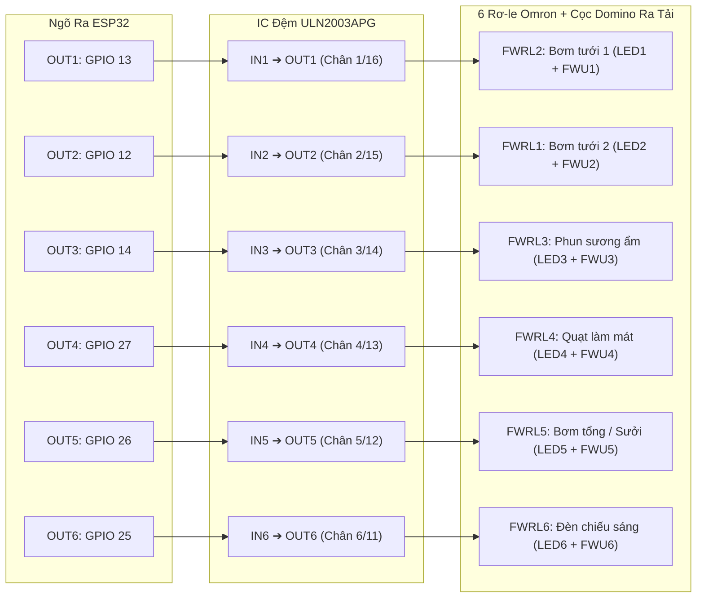

# Sơ Đồ Đấu Dây & Ma Trận Chân Chức Năng (Wiring & Pinout Guide)

Tài liệu này định nghĩa chính xác 100% sơ đồ chân, bus truyền thông, khối nguồn và giao tiếp ngoại vi theo bản vẽ nguyên lý chính thức:
- **Trạm Gateway**: [`Schematic_Gateway_Server.png`](../hardware/schematics/png/Schematic_Gateway_Server.png) và [`PCB_Gateway_Server.png`](../hardware/pcb/png/PCB_Gateway_Server.png)
- **Điểm đo Sensor Node**: [`Schematic_Sensor_Node_ATmega8.png`](../hardware/schematics/png/Schematic_Sensor_Node_ATmega8.png)

---

## 1. Mạch Gateway Trung Tâm (ESP32 Gateway Board)

### A. Giao Tiếp Cảm Biến, Phao Nước & Màn Hình LCD

| Ngoại vi / Cảm biến | Tín hiệu | Chân ESP32 | Mức điện áp | Mạch phối hợp trên PCB | Chức năng kỹ thuật |
| :--- | :--- | :---: | :---: | :---: | :--- |
| **Màn hình LCD 1602** (PCF8574T) | **SDA** | **GPIO 21** | 3.3V Logic | Nối chung bus I2C | Truyền dữ liệu I2C (Địa chỉ mặc định: `0x27`) |
| | **SCL** | **GPIO 22** | 3.3V Logic | Nối chung bus I2C | Xung nhịp đồng bộ I2C Clock |
| **Cảm biến ánh sáng GY-302** (BH1750) | **SDA** | **GPIO 21** | 3.3V Logic | Header 5-Pin | Chung bus I2C với LCD (Địa chỉ: `0x23`) |
| | **SCL** | **GPIO 22** | 3.3V Logic | Header 5-Pin | Chung bus I2C với LCD |
| **Cảm biến nhiệt ẩm DHT11** | **DATA** | **GPIO 32** | 3.3V / 5V | Trở kéo tích hợp | Giao tiếp 1-Wire đọc nhiệt độ & độ ẩm không khí |
| **Phao báo mức nước (IN PHAO)** | **IN33** | **GPIO 33** | 3.3V Logic | Cổng cắm Header P2 | Cảm biến phao cơ ngắt khẩn cấp khi cạn nước bể |
| **Cảm biến khí gas MQ-135** | **AOUT** | **GPIO 34** | 0 - 3.3V ADC | Cầu trở $R_9 (3.3\text{k}) + R_{11} (6.8\text{k})$ | Đo nồng độ khí NH3, CO2 (chuyển $5\text{V} \rightarrow 3.37\text{V}$ an toàn) |
| **Bo khuếch đại điện cực pH-4502C** | **Po** | **GPIO 35** | 0 - 3.3V ADC | Cầu trở $R_{10} (3.3\text{k}) + R_{12} (6.8\text{k})$ | Đo nồng độ pH dung dịch dinh dưỡng qua đầu dò BNC |

> [!TIP]
> **Thiết kế phân áp bảo vệ ADC**: Vi điều khiển ESP32 chỉ chịu được điện áp tối đa 3.3V trên các chân ADC. Các module MQ-135 và pH-4502C vận hành ở nguồn 5V nên ngõ ra analog có thể vượt ngưỡng 3.3V. Thiết kế PCB của tác giả đã tích hợp sẵn 2 cầu phân áp chính xác $R_9/R_{11}$ và $R_{10}/R_{12}$ theo hệ số $\frac{6.8}{3.3 + 6.8} \approx 0.673$, giúp đưa điện áp 5V về mức cực đại $3.37\text{V}$ tuyệt đối an toàn cho bộ chuyển đổi tương tự-số của ESP32.

---

### B. Module Thu Phát Vô Tuyến NRF24L01+ (SPI Bus)

| Tín hiệu NRF24L01 | Chân ESP32 | Chiều tín hiệu | Mức điện áp | Ghi chú kỹ thuật |
| :---: | :---: | :---: | :---: | :--- |
| **CE** | **GPIO 17** | ESP32 $\rightarrow$ NRF24 | 3.3V Logic | Chip Enable (kích hoạt chế độ RX/TX) |
| **CSN** | **GPIO 5** | ESP32 $\rightarrow$ NRF24 | 3.3V Logic | SPI Chip Select Not (Tích cực mức THẤP) |
| **SCK** | **GPIO 18** | ESP32 $\rightarrow$ NRF24 | 3.3V Logic | SPI Bus Clock phần cứng |
| **MISO** | **GPIO 19** | NRF24 $\rightarrow$ ESP32 | 3.3V Logic | SPI Master-In Slave-Out |
| **MOSI** | **GPIO 23** | ESP32 $\rightarrow$ NRF24 | 3.3V Logic | SPI Master-Out Slave-In |
| **VCC** | Nguồn 3.3V | Cấp nguồn | **3.3V ONLY** | Cấp riêng từ IC KU1 (AMS1117-3.3V), kèm tụ lọc KC2 |
| **GND** | Mass | Cấp nguồn | 0V | Nối mass chung toàn bo mạch |

---

### C. Khối Đệm Công Suất ULN2003APG & 6 Rơ-le Omron Tích Hợp

Khối công suất trên bo mạch Gateway sử dụng IC đệm Darlington **ULN2003APG** dập xung ngược bằng đi-ốt **1N4148** để kéo trực tiếp 6 cuộn hút rơ-le Omron 12V DC:

| Tên Rơ-le | Chân ESP32 | Kênh ULN2003 | Đi-ốt dập xung | Đèn LED báo | Cọc Domino | Thiết bị tải điều khiển |
| :---: | :---: | :---: | :---: | :---: | :---: | :--- |
| **FWRL2** | **GPIO 13** | IN1 (Pin 1) $\rightarrow$ OUT1 (Pin 16) | **FWD2** (1N4148) | **LED1** + $R_3 (1\text{k})$ | **FWU1** | Máy bơm tưới khu vực 1 |
| **FWRL1** | **GPIO 12** | IN2 (Pin 2) $\rightarrow$ OUT2 (Pin 15) | **FWD1** (1N4148) | **LED2** + $R_4 (1\text{k})$ | **FWU2** | Máy bơm tưới khu vực 2 |
| **FWRL3** | **GPIO 14** | IN3 (Pin 3) $\rightarrow$ OUT3 (Pin 14) | **FWD3** (1N4148) | **LED3** + $R_5 (1\text{k})$ | **FWU3** | Máy phun sương tạo ẩm |
| **FWRL4** | **GPIO 27** | IN4 (Pin 4) $\rightarrow$ OUT4 (Pin 13) | **FWD4** (1N4148) | **LED4** + $R_6 (1\text{k})$ | **FWU4** | Quạt thông gió làm mát |
| **FWRL5** | **GPIO 26** | IN5 (Pin 5) $\rightarrow$ OUT5 (Pin 12) | **FWD5** (1N4148) | **LED5** + $R_7 (1\text{k})$ | **FWU5** | Bơm cấp dinh dưỡng tổng / Thiết bị sưởi |
| **FWRL6** | **GPIO 25** | IN6 (Pin 6) $\rightarrow$ OUT6 (Pin 11) | **FWD6** (1N4148) | **LED6** + $R_8 (1\text{k})$ | **FWU6** | Đèn chiếu sáng quang hợp ban đêm |

---

### D. Hệ Thống 4 Phím Điều Hướng Menu & Nút Reset Cứng

Các phím bấm được thiết kế với điện trở treo nguồn $10\text{k}\Omega$ lên 3.3V, khi nhấn sẽ đóng tiếp điểm nối đất GND:

| Phím bấm | In lụa PCB (Silkscreen) | Chân ESP32 | Điện trở kéo lên | Mức logic tích cực | Chức năng thao tác HMI |
| :---: | :---: | :---: | :---: | :---: | :--- |
| **CHỌN** | `KEY2` | **GPIO 16** | $R_{18} (10\text{k}\Omega)$ | LOW (Nhấn nối GND) | Vào Menu chính, xác nhận lựa chọn, lưu ngưỡng cài đặt |
| **THOÁT** | `THOAT` | **GPIO 15** | $R_{15} (10\text{k}\Omega)$ | LOW (Nhấn nối GND) | Trở lại màn hình trước, chuyển từ chế độ Thủ công sang Tự động |
| **TĂNG** | `TANG` | **GPIO 2** | $R_{17} (10\text{k}\Omega)$ | LOW (Nhấn nối GND) | Di chuyển con trỏ lên, tăng giá trị ngưỡng tác động rơ-le |
| **GIẢM** | `GIAM` | **GPIO 4** | $R_{16} (10\text{k}\Omega)$ | LOW (Nhấn nối GND) | Di chuyển con trỏ xuống, giảm giá trị ngưỡng tác động rơ-le |
| **RESET** | `RST` | **Chân EN** | $R_{19} (10\text{k}\Omega)$ | LOW (Nhấn nối GND) | Khởi động lại phần cứng vi điều khiển tức thời |

---

## 2. Mạch Điểm Đo Cảm Biến Di Động (ATmega8 Sensor Node)

### A. Kết Nối Vi Điều Khiển ATmega8 Với NRF24L01+

| Tín hiệu RF | Chân chức năng ATmega8 | Chân vật lý DIP-28 | Chân trên NRF24 Breakout | Ghi chú kỹ thuật |
| :---: | :---: | :---: | :---: | :--- |
| **CE** | **PD7** | Chân 13 | Pin 3 (CE) | Điều khiển bật tắt chế độ thu/phát sóng |
| **CSN** | **PB0** | Chân 14 | Pin 4 (CSN) | Chọn chip SPI (Tích cực LOW) |
| **SCK** | **PB5** | Chân 19 | Pin 5 (SCK) | Xung nhịp phần cứng SPI Clock |
| **MISO** | **PB4** | Chân 18 | Pin 7 (MISO) | SPI Master-In Slave-Out |
| **MOSI** | **PB3** | Chân 17 | Pin 6 (MOSI) | SPI Master-Out Slave-In |
| **LED** | **PD5** | Chân 11 | Nối qua trở $R_2 (220\Omega)$ | Đèn LED2 (Đỏ) nháy sáng khi gửi gói tin RF |

### B. 6 Cổng Mở Rộng Cắm Cảm Biến Độ Ẩm Đất (P1 – P6)

Bo mạch Node tích hợp sẵn 6 hàng rào cắm Header 3 Pin bước $2.54\text{mm}$:
- **Chân 1**: Tín hiệu đo tương tự Analog (kết nối trực tiếp vào 6 kênh ADC của vi điều khiển).
- **Chân 2**: Nguồn nuôi cảm biến `VCC` (3.3V DC lấy sau IC ổn áp AMS1117-3.3V).
- **Chân 3**: Mass `GND`.

| Cổng cắm | Chân ATmega8 (DIP-28) | Kênh ADC | Thiết bị kết nối |
| :---: | :---: | :---: | :--- |
| **P1** | **PC0** (Chân 23) | **ADC0** | Que đo độ ẩm đất điện dung số 1 |
| **P2** | **PC1** (Chân 24) | **ADC1** | Que đo độ ẩm đất điện dung số 2 |
| **P3** | **PC2** (Chân 25) | **ADC2** | Que đo độ ẩm đất điện dung số 3 |
| **P4** | **PC3** (Chân 26) | **ADC3** | Que đo độ ẩm đất điện dung số 4 |
| **P5** | **PC4** (Chân 27) | **ADC4** | Que đo độ ẩm đất điện dung số 5 |
| **P6** | **PC5** (Chân 28) | **ADC5** | Que đo độ ẩm đất điện dung số 6 |

### C. Cổng Nạp Chương Trình Nạp ISP Chuẩn (Header U4 1x6 Pin)

| Thứ tự chân U4 | Tín hiệu ISP | Chân vi điều khiển ATmega8 | Chức năng khi nạp qua USBasp |
| :---: | :---: | :---: | :--- |
| **Pin 1** | **SCK** | PB5 (Chân 19) | Xung nạp ISP Clock |
| **Pin 2** | **MISO** | PB4 (Chân 18) | Dữ liệu Master-In Slave-Out |
| **Pin 3** | **MOSI** | PB3 (Chân 17) | Dữ liệu Master-Out Slave-In |
| **Pin 4** | **RST** | PC6 (Chân 1) | Chân Reset kéo xuống LOW để nạp code |
| **Pin 5** | **VCC** | Chân 7 (VCC) | Cấp nguồn 3.3V - 5V từ mạch nạp |
| **Pin 6** | **GND** | Chân 8/22 (GND) | Nối mass chung |
